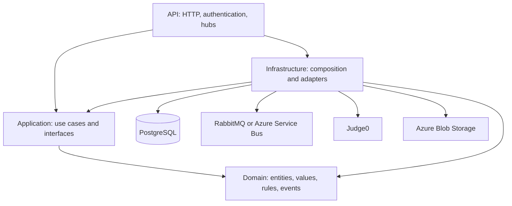

# StackDuel Server study guide

This guide describes the code in this repository as inspected on October 16, 2026. Versions are repository declarations, not claims about the latest releases or the software currently deployed. Start with [the tech stack](TECH_STACK.md) for the dependency inventory.

## 1. What the system does

StackDuel is a competitive programming backend. Its features include problems and test suites, code submissions, timed games, leaderboards, campaigns, daily challenges, achievements, user profiles, authorization, and feature flags. The difficult engineering topics are maintaining domain rules, executing code asynchronously, coordinating concurrent requests and workers, and delivering progress to clients.

The backend is organized as one application across multiple projects. Separate projects and bounded contexts do not by themselves imply independently deployed microservices.

## 2. Architecture and dependency direction



These arrows show project dependencies and external integrations. Runtime calls can cross an interface into Infrastructure even though Application has no project reference to Infrastructure.

| Project | Responsibility | Read first |
| --- | --- | --- |
| `StackDuel.Domain` | Business state, invariants, value objects, events, repository contracts | `SeedWork/AggregateRoot.cs`, `Games/Entities/Game.cs` |
| `StackDuel.Application` | Commands, queries, handlers, application services, DTOs and ports | `ApplicationServiceRegistration.cs`, `Commands/Games/CreateGame/CreateGameHandler.cs` |
| `StackDuel.Infrastructure` | Persistence, message transports, execution adapters, storage, scheduled work | `InfrastructureServiceRegistration.cs` |
| `StackDuel.Api` | HTTP contracts, middleware, authentication, authorization and real-time endpoints | `Program.cs`, `ApiServiceRegistration.cs` |
| `StackDuel.Seeder` | One-shot static/demo data setup | `Program.cs` |

**Pattern: Clean Architecture and dependency inversion.** Inner layers describe what they need using interfaces; Infrastructure implements those interfaces. The API is the composition root that registers all layers.

**Why it helps:** business logic can be tested without a broker, database, or HTTP host.

**Tradeoff:** more interfaces, DTOs, registration code, and navigation between files.

**Practice:** trace `IGameWriteRepository` from its Domain contract to `GameWriteRepository` and its dependency injection registration. Explain why `CreateGameHandler` can use it without referencing EF Core.

Architecture tests in [LayerBoundaryTests.cs](StackDuel.ArchitectureTests/LayerBoundaryTests.cs) enforce selected dependency restrictions. Read the exact assertions; a test suite only enforces the rules it actually names.

## 3. CQRS, mediator, and feature-oriented handlers

**CQRS** separates requests that change state (commands) from requests that read state (queries). Here, commands and queries have dedicated types and handlers, grouped by feature and operation.

Read:

- [CreateGameHandler.cs](StackDuel.Application/Commands/Games/CreateGame/CreateGameHandler.cs)
- [SubmissionService.cs](StackDuel.Application/Services/Submissions/SubmissionService.cs)
- `StackDuel.Application/Commands/ICommand.cs`
- `StackDuel.Application/Queries/IQuery.cs`
- `StackDuel.Infrastructure/Persistence/Read/StackDuelReadDbContext.cs`

An application service can translate its DTO into a command or query and call `IMediator.Send`. MediatR selects the handler and applies registered pipeline behaviors.

CQRS here does not require a separate read database. The dedicated read context contains row models for selected concerns such as users and authorization; it is not a second model of every feature.

**Why it helps:** each use case has a focused entry point, dependencies, and tests.

**Tradeoff:** simple changes may touch a request, handler, validator, service, and API contract.

**Practice:** follow submission creation from controller to service to command handler. Then follow its status query. Identify which parts read state and which parts change state.

## 4. Domain-driven design: entities, aggregates, value objects, factories

| Concept | Meaning | Repository example | What to study |
| --- | --- | --- | --- |
| Entity | Identity persists while state changes | `Games/Entities/GameParticipant.cs` | Identity versus property equality |
| Aggregate root | Entry point for a related graph and its rules | `Games/Entities/Game.cs`, `SeedWork/AggregateRoot.cs` | Which changes belong together |
| Value object | A domain value with validation and value semantics | `Users/ValueObjects/Username.cs` | Construction rules and invalid values |
| Factory | Centralized aggregate creation | `Users/Factories/UserFactory.cs` | Creation dependencies and initial state |
| Domain event | A business fact produced by a state change | `Games/Events`, `Submissions/Events` | Trigger, payload and subscribers |
| Bounded context | A conceptual boundary around a domain vocabulary | Games, Campaigns, Authorization, FeatureFlags | Ownership of rules and data |

The Domain project has no declared NuGet package references. `AggregateRoot` stores domain events and exposes `PopDomainEvents`, which returns and clears them.

**Why it helps:** rules remain close to the state they protect, rather than being duplicated in HTTP endpoints.

**Tradeoff:** persistence must map richer objects and private state, and event-driven effects require more tracing.

**Practice:** select a method on `Game` that changes its lifecycle. List its preconditions, changes, and emitted events. Find the tests for both a valid transition and a rejected transition.

## 5. Validation, results, and the template method pattern

[AbstractCommandHandler.cs](StackDuel.Application/Commands/AbstractCommandHandler.cs) implements the common handling algorithm:

1. Run an optional FluentValidation validator.
2. Translate failures into Ardalis validation errors.
3. Return an invalid result or call `HandleValidated`.

This is the **template method pattern**: the base class owns the algorithm while subclasses implement the operation-specific step.

`CreateGameHandler` also checks database-dependent rules: valid tracks, active languages, mode permissions, and allowed durations. A request being structurally valid does not mean it is allowed in the current business state.

Ardalis results represent expected outcomes such as success, not found, forbidden, and invalid. Inspect API result translation and global exception middleware to understand how those outcomes become HTTP responses.

**Important implementation detail:** validation is in the command base classes. The registered open MediatR behaviors are logging and audit; do not assume there is a validation pipeline behavior.

**Practice:** classify each check in `CreateGameHandler` as input validation, existence validation, authorization, or domain policy. Explain why each belongs where it is.

## 6. Pipeline behaviors and cross-cutting concerns

Read `StackDuel.Application/Behavior/LoggingBehavior.cs` and `AuditBehavior.cs`, plus `ApplicationServiceRegistration.cs`.

MediatR behaviors wrap handler execution. This resembles a decorator pipeline: shared behavior surrounds a use case without being copied into every handler. Audit support also has an `IAuditableCommand` contract.

**Why it helps:** logging and audit concerns have consistent integration points.

**Tradeoff:** behavior can be less visible at the call site. Registration order and error handling matter.

**Practice:** draw the execution order for a command, including behaviors, validation and handler execution. Inspect whether failed commands are audited and which fields are recorded rather than guessing from the class name.

## 7. Repositories, EF Core, and database correctness

Read:

- [StackDuelDbContext.cs](StackDuel.Infrastructure/Persistence/StackDuelDbContext.cs)
- [GameWriteRepository.cs](StackDuel.Infrastructure/Repositories/Games/GameWriteRepository.cs)
- `StackDuel.Infrastructure/Persistence/Configuration`
- `StackDuel.Infrastructure/Repositories/Users/UserReadRepository.cs`

Repository contracts separate use cases from persistence details. EF configuration classes describe mappings, relationships, indexes and conversions. The write context applies global filters for published problems and active languages/versions.

Repository methods such as `GameWriteRepository.AddAsync` save changes themselves. Do not assume every command runs inside a shared transaction or a separate Unit of Work abstraction.

Two especially useful examples:

1. **Child entity tracking:** new children already have GUIDs. The game repository explicitly marks detached children as added so EF inserts them correctly.
2. **Concurrent sequence updates:** the unique index on game/problem position resolves a race. The repository translates the specific database conflict into `GameProblemPositionConflictException` and detaches the failed graph so a retry can reload fresh state.

**Practice:** explain why checking for a duplicate before inserting is insufficient under concurrency. Then explain why retrying with the same tracked graph can preserve stale state.

**Study questions:** When should a query project directly into a DTO? What can a global query filter hide from an admin query? Which save operations are atomic together?

## 8. Domain events, broker messages, and eventual consistency

Domain events and broker messages have different roles. A domain event describes a business fact inside the application. A message transports work between producers and consumers.

[SubmissionCreatedDomainEventHandler.cs](StackDuel.Application/Events/Submissions/SubmissionCreatedDomainEventHandler.cs) illustrates the bridge: it handles a wrapped domain event and publishes a `SubmissionCreatedMessage` through `IMessagePublisher`.

Study the full path through:

- `StackDuel.Application/Events/MediatRDomainEventDispatcher.cs`
- `StackDuel.Application/Commands/Submissions/CreateSubmission/CreateSubmissionHandler.cs`
- `StackDuel.Infrastructure/Messaging/Consumers`
- `StackDuel.Infrastructure/Jobs/Submissions/SubmissionJobProcessorService.cs`

**Why it helps:** code execution and follow-up work can happen after the initial HTTP request.

**Tradeoff:** clients observe intermediate states, and failures can occur between persistence, publication, execution and notification.

Do not infer exactly-once delivery, event sourcing, or a transactional outbox merely from the presence of events and a broker. Verify persistence/publication ordering and recovery logic in each path.

**Practice:** draw the submission flow and mark every database write and external call. For each boundary, ask what happens if the process stops immediately afterward.

## 9. Background processing, leases, and recovery

[SubmissionJobRepository.cs](StackDuel.Infrastructure/Repositories/SubmissionJobs/SubmissionJobRepository.cs) contains a concrete worker coordination pattern:

- `TryClaimAsync` uses a conditional database update to set `LockedUntil` only for eligible, unleased jobs.
- The affected-row count tells the worker whether it obtained the claim.
- `FindPendingAsync` finds pending/running jobs whose leases are absent or expired.
- `PersistAttemptAsync` saves an attempt before the step handler executes.
- Quartz schedules a sweep alongside message-driven continuation processing.

This combines fast message-triggered work with periodic recovery of idle or orphaned jobs.

**Tradeoff:** a lease expires with time; its existence alone does not prove that all external side effects are safe to repeat. Study lease duration and step retry semantics together.

**Practice:** model two workers claiming the same job, a worker crashing after claiming, and an external execution request succeeding before the worker saves its outcome. Identify which scenarios the lease solves and which require additional repeat-safety logic.

## 10. Strategy, resolver, registry, and adapter patterns

| Pattern | Example | Purpose |
| --- | --- | --- |
| Strategy | `IProblemSelectionStrategy`, `DifficultyRampProblemSelectionStrategy` | Select problems according to a replaceable policy |
| Strategy | `ICodeTemplateStrategy`, Java/Python/React template implementations | Generate language-specific executable code |
| Resolver | `CodeTemplateStrategyResolver`, `ProblemSelectionStrategyResolver` | Choose an implementation using runtime information |
| Registry | `StepHandlerRegistry` | Locate a handler for an execution step |
| Adapter | `Judge0ExecutionEngineStrategy`, `AzureAvatarBlobStorage` | Translate application needs into external service operations |
| Transport abstraction | `IMessagePublisher` with RabbitMQ/Azure implementations | Select a messaging implementation through configuration |

**Why it helps:** new languages or integrations can be added without expanding one central conditional into all implementation details.

**Tradeoff:** keys, registration, supported capabilities, and resolver behavior must remain consistent.

**Practice:** sketch how to add a language template. List the strategy, registration, resolver inputs, static data, and output-parsing tests needed. Distinguish code template generation from the external compiler/runtime that executes it.

## 11. Authentication, authorization, flags, and real-time delivery

Study `StackDuel.Api/Authorization`, `AccountContextMiddleware`, `StackDuel.Application/UserContext.cs`, and `StackDuel.Application/Services/FeatureFlags`.

- **Authentication:** Auth0-issued JWTs establish caller identity.
- **Authorization:** user context, permissions, roles/groups and restrictions determine allowed actions.
- **Feature flags:** operational availability is resolved separately from permanent permissions. The documented precedence is user override, group override, deterministic rollout, then default; deny takes precedence within an override layer.
- **Rate limiting and CORS:** API middleware handles request admission and allowed browser origins.
- **SignalR:** game and submission hubs deliver application updates.
- **Language server:** the optional Java bridge uses a raw WebSocket and local jdtls processes; it is a separate mechanism from the SignalR hubs.

**Practice:** explain why a flag being enabled does not grant a permission. Trace one protected operation from endpoint attributes through user context and handler checks. Inspect hub group membership before assuming notifications are isolated correctly.

## 12. Testing and engineering practices

| Test project | Focus | Exercise |
| --- | --- | --- |
| `StackDuel.Domain.Tests` | Entities and value-object rules | Add a boundary case for an invariant |
| `StackDuel.Application.Tests` | Handlers, validators and services with test doubles | Cover invalid input, forbidden access and success |
| `StackDuel.Api.Tests` | Controller behavior | Check result/status translation |
| `StackDuel.Infrastructure.Tests` | Execution templates and parsing | Test malformed executor output |
| `StackDuel.IntegrationTests` | Hosted API plus disposable PostgreSQL | Verify persistence and authorization through HTTP |
| `StackDuel.ArchitectureTests` | Selected dependency boundaries | Explain the dependency each assertion prevents |
| `StackDuel.Specs` | Reqnroll behavior specifications | Read `Features/Users/CreateUser.feature` and its steps |

Integration tests use Testcontainers and the application's migrations. They replace authentication with a test scheme and remove the broker-backed consumer. They do not establish that every real external service works in production.

Other practices visible in the repository:

- Central package versions in `Directory.Packages.props`.
- Nullable reference types and implicit usings in project files.
- Constructor dependency injection; many handlers use primary constructors and `internal sealed` implementations.
- Async I/O and cancellation tokens across application/repository contracts.
- EF migrations and distinct static/demo seed paths.
- User secrets locally and environment configuration for deployment.
- `.editorconfig`, CI format verification, and a pinned CSharpier tool.
- GitHub Actions for builds/tests, deployment, SonarCloud, CodeQL and dependency security auditing.
- Source templates under `templates` for repeatable feature structure.

Useful commands from the repository root:

```powershell
dotnet restore StackDuel.slnx
dotnet build StackDuel.slnx --configuration Release --no-restore
dotnet test StackDuel.Domain.Tests
dotnet test StackDuel.Application.Tests
dotnet test StackDuel.ArchitectureTests
dotnet test StackDuel.IntegrationTests
dotnet format StackDuel.slnx --verify-no-changes --no-restore
```

Integration tests need Docker. Follow [README.md](README.md) for local service setup, secrets, migrations and seeding. These commands are study instructions, not a report that this documentation change ran the application tests.

## 13. Suggested study schedule

| Session | Topic | Deliverable |
| --- | --- | --- |
| 1 | Project boundaries and dependency injection | Draw project dependencies and trace one interface registration |
| 2 | CQRS, validation and result handling | Trace create-game from HTTP request to persistence and response |
| 3 | Aggregates and value objects | Explain one invariant and its tests |
| 4 | EF mappings and read models | Trace a query and inspect its filtering/projection |
| 5 | Events and asynchronous submissions | Diagram writes, messages, steps and notifications |
| 6 | Concurrency and recovery | Analyze duplicate delivery, expired leases and position conflicts |
| 7 | Security, flags and real-time communication | Trace one permission check and one notification subscription |
| 8 | Testing and delivery | Run relevant tests and explain CI/deployment stages |

## 14. Capstone practice

In a separate branch, add one small admin query using an existing domain concept. Use the closest existing query as a reference.

1. Define the request and response DTO, including sensible pagination if returning a collection.
2. Add the query handler and read repository operation.
3. Expose it through the existing application-service/API conventions.
4. Apply the correct user and permission requirements.
5. Add focused handler tests and an HTTP integration test for denied and permitted access.
6. Verify formatting and selected architecture tests.

You should be able to explain every new dependency, where expected failures are represented, what data is visible to the caller, and which checks require a real database.

## 15. Self-check questions

1. How does dependency inversion differ from merely putting code in separate projects?
2. Why can a command pass FluentValidation and still return forbidden or invalid?
3. What belongs in an aggregate instead of a controller?
4. Why does CQRS not require separate databases?
5. What is the difference between a domain event and a broker message?
6. What happens if a process dies between saving state and publishing a message?
7. Why use a conditional update to claim a job?
8. Why is a database uniqueness constraint needed even with an application check?
9. What is the difference between authentication, permission and feature availability?
10. Which tests prove domain correctness, HTTP behavior, database behavior and architecture boundaries?
